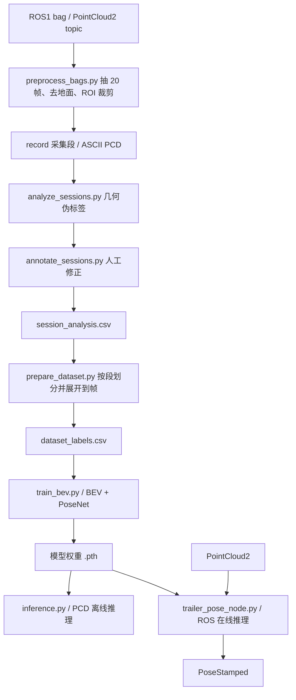

# 拖挂 / 托盘位姿估计工程

本工程是一个 ROS1 Catkin 工作空间，核心功能包为 `trailer_pose`。它将激光雷达点云转换为 BEV（鸟瞰图），通过 PyTorch CNN 回归挂钩位置与拖挂朝向，可用于 PCD 离线推理和 ROS 点云在线推理。

| 输出 | 含义 | 单位 / 表示 |
| --- | --- | --- |
| `hook_x` | 挂钩纵向位置 | 米 |
| `hook_y` | 挂钩横向位置 | 米 |
| `angle` | 拖挂尾部指向挂钩的方向角 | 独立推理为度，ROS 输出为 yaw 四元数 |

工程包含 ROS1 bag 离线抽帧、去地面及 ROI 裁剪，以及数据分析、人工标注、数据集划分、模型训练和推理流程。在线雷达驱动、坐标变换、预处理节点和车辆控制需要另外配置。

已支持多车型标注、按车型分层划分、联合训练，以及自动识别或指定车型推理，步骤见 [多车型使用说明](src/trailer_pose/docs/multi_type_training.md)。现有权重仍为旧版单车型模型，多车型能力需要用带车型标签的数据重新训练。

包内更详细的操作说明见 [trailer_pose/README.md](src/trailer_pose/README.md)。以下命令均从工作空间根目录执行；实际部署时请替换工作空间绝对路径。

## 1. 工程结构

```text
catkin_ws/
├── README.md                         # 工程入口说明
├── src/
│   ├── CMakeLists.txt                 # Catkin 入口，链接到 ROS Noetic
│   └── trailer_pose/
│       ├── package.xml               # 功能包信息及 ROS 依赖
│       ├── CMakeLists.txt            # Python 脚本、launch、模型安装规则
│       ├── README.md                 # 详细使用说明
│       ├── scripts/
│       │   ├── analyze_sessions.py   # 几何分析，生成段级伪标签
│       │   ├── annotate_sessions.py  # 图形显示点云，人工修正段级标签
│       │   ├── annotate_pose_gui.py  # BEV 拖拽标注 x、y、heading，支持断点继续
│       │   ├── annotate_open3d.py    # Open3D 点选挂钩 / 方向并保存标签
│       │   ├── prepare_dataset.py    # 按采集段划分集合，再展开到帧
│       │   ├── preprocess_bags.py    # 从 ROS1 bag 抽帧、去地面、裁剪并导出 PCD
│       │   ├── train_bev.py          # PCD 读取、BEV、PoseNet、训练和验证
│       │   ├── trailer_types.py      # 车型名称与旧标签兼容处理
│       │   ├── inference.py          # 单帧 / 目录 PCD 推理
│       │   ├── pcd_publisher.py      # PCD 转为 ROS PointCloud2 发布
│       │   └── trailer_pose_node.py  # 订阅点云、推理并发布 PoseStamped
│       ├── launch/
│       │   ├── offline_test.launch   # PCD 发布 + 位姿估计
│       │   └── trailer_pose.launch   # 在线位姿估计
│       ├── models/
│       │   └── best_pose_model.pth   # 已有模型权重
│       ├── data/
│       │   ├── bag_combined/         # record*/ 采集段及 ASCII PCD
│       │   ├── session_analysis.csv  # 段级标签，数据集生成的输入
│       │   ├── dataset_labels.csv    # 帧级标签、PCD 绝对路径和集合划分
│       │   ├── session_labels.csv    # 已有段级分箱统计
│       │   └── test_predictions.csv  # 已有测试集预测结果
│       └── docs/
│           ├── 采集数据.jpg          # 数据采集说明
│           └── images/              # 点云、覆盖分布、测试结果图
├── build/                            # Catkin 构建产物
└── devel/                            # Catkin 开发环境与节点入口
```

根目录另有 `.venv-labelcloud/` 和 `1.png`，当前功能包脚本没有引用它们。

## 2. 处理流程



训练标签以采集段为单位，同一 `record*` 目录内的所有帧共享同一组位置和角度，因此每段应保持目标静止或近似静止。已有可靠的外部段级标签时，可以跳过几何伪标签生成和人工标注步骤。

## 3. 环境与构建

工程使用 ROS1 Noetic、Python 3 和 PyTorch，没有 C++ 推理代码。当前环境为 Python 3.8.10、PyTorch 2.4.1+cpu、NumPy 1.24.4、SciPy 1.10.1、Matplotlib 3.7.5；工程未提供锁定版本的依赖文件。

| 依赖 | 用途 |
| --- | --- |
| ROS Noetic / Catkin | 构建、启动及 ROS 通信 |
| `rospy`、`sensor_msgs`、`geometry_msgs`、`std_msgs`、`tf` | 点云消息、位姿消息和四元数转换 |
| `rosbag` | 离线读取 bag 中的 PointCloud2 并预处理导出 |
| PyTorch、NumPy | 网络训练、推理与 BEV 转换 |
| SciPy | 几何伪标签的连通域分析 |
| Matplotlib、Tkinter | 人工标注工具，使用 `TkAgg` 后端 |

安装缺少的 Python 依赖，并确保它们可被 ROS 节点使用的 Python 解释器导入：

```bash
python3 -m pip install torch numpy scipy matplotlib

# 使用人工标注工具且缺少 Tkinter 时安装
sudo apt install python3-tk
```

构建并加载工作空间：

```bash
cd /home/zyd/tuogua/catkin_ws
source /opt/ros/noetic/setup.bash
catkin_make
source devel/setup.bash
```

每个运行 ROS 命令的新终端都需要加载 ROS 和工作空间环境。训练与独立 PCD 推理不需要启动 ROS Master。训练和推理会自动选择 CUDA，不可用时使用 CPU。

## 4. 快速运行

### 4.1 独立 PCD 推理

直接使用已有权重，不需要启动 ROS：

```bash
cd /home/zyd/tuogua/catkin_ws

# 单帧，输出 hook_x、hook_y 和 angle
python3 src/trailer_pose/scripts/inference.py \
  src/trailer_pose/data/bag_combined/record20260818_103645/record20260818_103645_0001.pcd

# 对一个采集段的全部 PCD 进行推理后取平均
python3 src/trailer_pose/scripts/inference.py \
  src/trailer_pose/data/bag_combined/record20260818_103645 --multi
```

目录模式去掉 `--multi` 即逐帧输出结果；只读取目录直接包含的 `.pcd / .PCD`，不递归搜索。通过 `--model PATH` 可指定其他权重。多帧平均对 x/y 使用算术平均，对角度使用正弦 / 余弦平均；多车型模型先按多数票选车型，只平均该车型的帧。`--trailer_type NAME` 可指定已知车型。

### 4.2 ROS 离线联调

```bash
cd /home/zyd/tuogua/catkin_ws
source /opt/ros/noetic/setup.bash
source devel/setup.bash

roslaunch trailer_pose offline_test.launch
```

默认以 10 Hz 循环发布示例采集段到 `/points_raw`，估计节点对最近 5 帧预测进行平滑，输出 `/trailer_pose`。`roslaunch` 会在需要时启动 ROS Master。

可覆盖的 launch 参数只有 `pcd_dir`、`rate` 和 `multi_frame`：

```bash
roslaunch trailer_pose offline_test.launch \
  pcd_dir:=/home/zyd/tuogua/catkin_ws/src/trailer_pose/data/bag_combined/record20260818_103645 \
  rate:=10 multi_frame:=5
```

在另一个已加载环境的终端查看结果：

```bash
rostopic echo /trailer_pose
```

### 4.3 ROS 在线推理

雷达驱动与预处理节点将符合训练坐标和 ROI 的点云发布到 `/points_raw` 后，执行：

```bash
roslaunch trailer_pose trailer_pose.launch
```

该 launch 固定使用包内权重、`/points_raw` 输入、`/trailer_pose` 输出和 5 帧窗口，没有声明可覆盖的 launch 参数。自定义配置时，可在 ROS Master 已启动的情况下直接运行节点：

```bash
rosrun trailer_pose trailer_pose_node.py \
  _model_path:=/home/zyd/tuogua/catkin_ws/src/trailer_pose/models/best_pose_model.pth \
  _cloud_topic:=/points_filtered \
  _pose_topic:=/trailer_pose \
  _frame_id:=lidar \
  _multi_frame:=5
```

## 5. 数据与训练

### 5.1 输入数据和标签

若数据来自 ROS1 bag，可先执行（替换实际 bag 路径和雷达 topic）：

```bash
source /opt/ros/noetic/setup.bash
python3 src/trailer_pose/scripts/preprocess_bags.py \
  --input /path/to/bags \
  --topic /lidar/points \
  --output_dir src/trailer_pose/data/bag_preprocessed
```

默认每个 bag 均匀抽取 20 帧，保留原始坐标 `x∈[-6,0] m`、`y∈[-1,1] m`，去除地面并逐帧输出 `x y z intensity` ASCII PCD。输入可为文件、多个文件或目录，不需要 ROS Master。每个 bag 生成一个 `record*` 采集段目录及处理记录 `manifest.json`。

默认保留原始坐标。预处理的 x 范围为 `[-6,0]` 米，当前训练与推理的 BEV 范围仍为 `[-5.2,0]` 米，不随预处理自动扩展。地面高度可用 `--ground_z` 指定，详细参数、地面拟合假设和标注入口见 [bag 预处理说明](src/trailer_pose/README.md#43-从-ros-bag-预处理生成-pcd)。

原始点云放在 `src/trailer_pose/data/bag_combined/record*/` 下。当前读取器支持 `DATA ascii` 的 PCD，按列使用 x、y、z；现有文件字段顺序为 `x y z intensity`。不支持二进制 PCD，也不会根据 PCD 头自动调整字段顺序。

外部段级标签至少应包含：

```csv
session,hook_x,hook_y,angle,length
record20260818_103645,-1.216,0.179,0.213,1.836
```

`session` 必须与采集段目录名一致；位置、长度单位为米，角度单位为度。`length` 用于数据筛选，不作为网络回归目标。

多车型数据增加 `trailer_type` 列；GUI 会同时保存绝对目录 `session_dir`。没有车型列的旧数据按 `default` 兼容读取，多车型训练前需要补齐实际车型。不同根目录的标注文件可通过 `--session_csv CSV_A CSV_B` 合并。

当前数据快照如下：

| 数据 | 采集段数 | 帧数 |
| --- | ---: | ---: |
| 原始 PCD | 647 | 12,664 |
| `session_analysis.csv` 段级标签 | 636 | — |
| `dataset_labels.csv` 筛选后合计 | 505 | 10,077 |
| train | 353 | 7,040 |
| val | 75 | 1,565 |
| test | 77 | 1,472 |

### 5.2 生成标签、划分和训练

推荐使用 [x、y、heading 可视化手工标注器](src/trailer_pose/docs/manual_pose_annotation.md)：默认快捷标注无需切换模式，左键位置、右键或蓝点调整朝向、`Shift+左键拖框` 放大、滚轮缩放、中键拖动平移，双击中键恢复全图。`Ctrl+滚轮` 微调角度，`F` 全图、`V` 上一视图。可通过按钮打开 PCD 或选择目录，并在左侧搜索、筛选和切换采集段。Enter 保存并进入下一段，只输出人工确认过的段，并支持断点继续。

使用 Open3D 点选真实点云的逐步演示见 [数据标注操作示例](src/trailer_pose/docs/data_annotation_demo.md)，包含点位示意图、独立点选工具、示例 CSV 和帧级标签生成结果。

以下示例输出到新文件，便于保留已有标签与权重。几何分析生成的是伪标签，应人工核对后再训练。

```bash
cd /home/zyd/tuogua/catkin_ws

# 1. 每段取前 5 帧，提取主要连通区域，估计挂钩和尾部位置
python3 src/trailer_pose/scripts/analyze_sessions.py \
  --data_dir src/trailer_pose/data/bag_combined \
  --output src/trailer_pose/data/session_analysis_new.csv

# 2. 人工修正，需要图形界面；逐段保存到新的 CSV
python3 src/trailer_pose/scripts/annotate_pose_gui.py \
  --data_dir src/trailer_pose/data/bag_combined \
  --initial_csv src/trailer_pose/data/session_analysis_new.csv \
  --output src/trailer_pose/data/session_manual_new.csv

# 3. 按段划分 train/val/test，再生成帧级标签
python3 src/trailer_pose/scripts/prepare_dataset.py \
  --data_dir src/trailer_pose/data/bag_combined \
  --session_csv src/trailer_pose/data/session_manual_new.csv \
  --output src/trailer_pose/data/dataset_labels_new.csv \
  --seed 42

# 4. 训练并按验证集分数保存最佳模型
python3 src/trailer_pose/scripts/train_bev.py \
  --label_csv src/trailer_pose/data/dataset_labels_new.csv \
  --model_path src/trailer_pose/models/experiment_pose_model.pth \
  --epochs 40 --batch_size 32 --lr 0.001
```

新标注器中，`Enter` 保存并前进，`S` 仅保存，`B` 返回，`N` 跳过；heading 使用度，保存为 CSV 的 `angle` 列。旧的 `annotate_sessions.py` 仍保留终端输入数值的方式。

数据筛选条件为 `-3.5 < hook_x < -0.9`、`abs(hook_y) < 0.9`、`length > 0.5`。通过筛选的段在每种车型内按约 70% / 15% / 15% 划分，同一绝对目录下的采集段不会跨集合。每种车型至少 3 段才能覆盖三个集合。`--seed` 只控制数据集划分，训练脚本没有固定随机种子。

如果直接使用已有帧级标签，只需执行训练命令，并将 `--label_csv` 改为 `src/trailer_pose/data/dataset_labels.csv`。标签生成命令会覆盖指定 CSV；训练会在验证集分数改善时覆盖指定模型。

### 5.3 模型实现

| 项目 | 当前实现 |
| --- | --- |
| BEV 范围 | x：`[-5.2, 0.0]` m；y：`[-1.2, 1.2]` m |
| 输入张量 | `2 × 128 × 256`，通道为点数密度和平均 z |
| 密度编码 | `log1p(count) / log1p(20)` |
| 网络 | 4 层步长为 2 的卷积，每层接 BatchNorm / ReLU，再接全局平均池化和回归头 |
| 网络输出 | 归一化 x、归一化 y、`sin(angle)`、`cos(angle)` |
| 解码 | `hook_x = pred[0] * 1.3 - 2.2`；`hook_y = pred[1]`；`angle = atan2(pred[2], pred[3])` |
| 数据增强 | 随机 ±5° 旋转、y 镜像、丢点、0.01 m 高斯噪声，仅训练集启用 |
| 损失 | 位置 SmoothL1 + 0.5 × 角度正弦 / 余弦 MSE |
| 优化器 | Adam，默认学习率 0.001，每 20 轮减半 |
| 模型选择 | 最小化 `hx_mae + hy_mae + 0.02 * ang_mae` |

上表为单车型路径；多车型使用共享特征、车型分类头和各车型独立回归头，损失增加 `0.2 × 车型交叉熵`，默认按车型均衡采样。最佳模型按各车型分数的平均值选择，验证输出同时包含各车型的误差和识别准确率。新权重文件内保存车型名称，旧版纯权重仍可直接加载。

训练、独立推理和 ROS 推理复用 [train_bev.py](src/trailer_pose/scripts/train_bev.py) 中的 BEV 与网络实现。修改 BEV 范围、网络结构或输出归一化时，需要同步处理训练和推理，并重新训练相应权重。

## 6. ROS 接口和参数

| 默认 Topic | 消息类型 | 方向 | 内容 |
| --- | --- | --- | --- |
| `/points_raw` | `sensor_msgs/PointCloud2` | 订阅 | 包含 `x y z intensity` 的点云 |
| `/trailer_pose` | `geometry_msgs/PoseStamped` | 发布 | 挂钩位置与拖挂朝向 |
| `/trailer_type` | `std_msgs/String` | 发布 | 当前所选车型名称，旧模型为 `default` |

估计节点支持以下私有参数，`rosrun` 中使用 `_参数名:=值` 设置：

| 参数 | 默认值 | 作用 |
| --- | --- | --- |
| `model_path` | 包内 `models/best_pose_model.pth`，源码运行时 | 模型权重路径 |
| `cloud_topic` | `/points_raw` | 输入点云 topic |
| `pose_topic` | `/trailer_pose` | 输出位姿 topic |
| `type_topic` | `/trailer_type` | 输出车型 topic |
| `trailer_type` | 空字符串 | 自动识别；填写模型词表中的名称可指定已知车型 |
| `frame_id` | `lidar` | 输入 frame_id 为空时的备用值 |
| `multi_frame` | `5` | 最近 N 个有效预测的平滑窗口，使用正整数 |

输出的 `position.x/y` 是挂钩位置，`position.z` 固定为 0。姿态只包含 yaw，`orientation.z = sin(yaw/2)`、`orientation.w = cos(yaw/2)`，其中 yaw 使用弧度。时间戳沿用输入点云，frame_id 优先沿用输入值；节点不执行 TF 坐标变换。

少于 10 个有效点时，节点仅输出警告，不发布新位姿。滑动窗口平均的是各帧预测结果；启动时不足 N 帧也会输出，车型切换时重置窗口。增大窗口可平滑结果，同时会增加运动过程中的响应滞后。两个 launch 文件均支持 `model_path / trailer_type / type_topic / multi_frame` 参数。

## 7. 已有评估结果

按 `data/test_predictions.csv` 中的 1,472 条已有预测重新计算平均绝对误差，角度误差按 ±180° 环绕处理：

| 指标 | MAE |
| --- | ---: |
| 挂钩 x | 0.208 m |
| 挂钩 y | 0.177 m |
| 方向角 | 10.124° |

这些数值来自已有预测文件。本次梳理未重新训练或重跑完整测试集，也未核验该文件与当前权重的对应关系。`train_bev.py` 只执行训练和验证，不会自动评估 test 集；现有脚本也不会自动重新生成 `session_labels.csv`、`test_predictions.csv` 和 `docs/images/`。

已有可视化：[点云样例](src/trailer_pose/docs/images/pcd_samples.png)、[覆盖热图](src/trailer_pose/docs/images/coverage_heatmap.png)、[挂钩位置变化](src/trailer_pose/docs/images/hook_timeline.png)、[测试结果](src/trailer_pose/docs/images/test_results.png)。采集说明见 [采集数据.jpg](src/trailer_pose/docs/采集数据.jpg)。

## 8. 接入约束与排查

- **坐标与 ROI**：输入应与训练数据使用相同的雷达安装、坐标约定和高度层。BEV 仅按 x/y 栅格索引筛选点，不主动裁剪 z，也不做地面分割；离线 bag 可用 `preprocess_bags.py` 去地面和裁剪，在线输入仍需外部预处理节点。该脚本默认保留 `x∈[-6,0]`、`y∈[-1,1]` 米，包内现有训练约定负 x 指向拖挂区域、y 左负右正，接入时应核对轴向和角度正方向。
- **点云字段**：网络特征只使用 x/y/z，但 ROS 节点显式读取 `intensity`，输入缺少该字段会出错。ASCII PCD 也需保持约定的列顺序。
- **迁移数据**：`dataset_labels.csv` 保存 PCD 绝对路径，移动工程或数据后应重新运行 `prepare_dataset.py`；段级 CSV 如含 `session_dir`，先更新到新目录。`test_predictions.csv` 是历史结果，其路径可能指向旧数据位置。
- **标签质量**：几何伪标签不等同于人工真值；标注工具会为没有已有标签的段填入默认位姿，直接按回车会保留这些值，训练前需要核对。
- **空数据**：没有有效采集段时，数据准备脚本会报错；训练需要非空的 train/val 集，且每种车型都应有训练和验证数据。
- **输出有效性**：多车型离线推理的分类概率不代表位姿精度；模型没有位姿置信度或目标存在概率。控制端需要根据消息时间戳和实际业务范围判断结果是否可用。
- **部署方式**：本文使用源码工作空间和 `devel` 环境；当前 CMake 安装规则不包含 `data/`，单独部署安装产物时需要另行提供离线点云。

ROS 没有位姿输出时，可先检查节点、输入频率和输出消息：

```bash
rosnode list
rostopic hz /points_raw
rostopic echo -n 1 /points_raw
rostopic echo -n 1 /trailer_pose
```

再确认输入 topic 与配置一致、点云字段完整、有效点数足够，以及模型权重路径和网络结构匹配。

## 9. GitHub 仓库关联

目标仓库：[zyd18342842908-maker/trailer_pose](https://github.com/zyd18342842908-maker/trailer_pose)。在本机终端运行：

```bash
cd /home/zyd/tuogua/catkin_ws
bash scripts/connect_github.sh
```

脚本会为未初始化的工程建立 Git 仓库并设置 `main` 分支，然后设置或核对 `origin`。已有的其他远程地址会保留并报错提示，重复运行不会覆盖配置。该步骤只完成关联，提交和推送需要另外执行。

根目录 `.gitignore` 默认排除点云、标注及其他本地数据、Python 虚拟环境、Catkin 编译输出、缓存和本地工具配置。代码、文档和已有小体积模型可纳入版本管理；数据目录的迁移方式见 [data/README.md](src/trailer_pose/data/README.md)。
