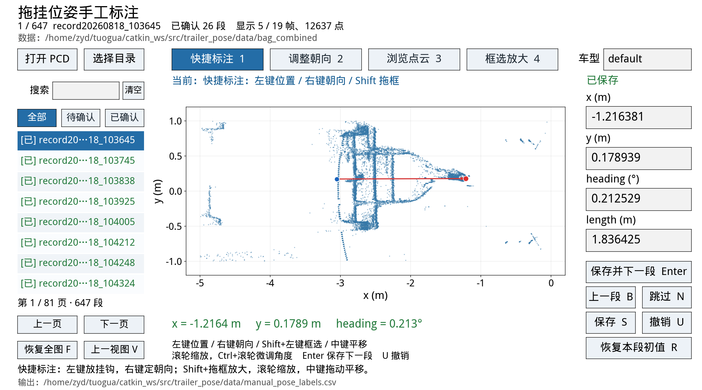

# x、y、heading 可视化手工标注

`scripts/annotate_pose_gui.py` 使用 Matplotlib 显示点云俯视图，可直接在二维图中放置挂钩中心、拖动朝向，不需要 Open3D、PyTorch 或 ROS。每个采集段目录共用一组标签，段内目标应保持静止或近似静止。



这张预览来自真实采集段的前 5 帧，显示已保存标签或已有初值；预览导出不会确认或保存标签。

点云显示区采用加宽布局，两侧面板收窄，输入框标签放在框上方。采集段名称会根据列表宽度自动省略中间部分，完整名称显示在顶部，搜索仍使用完整名称。

## 启动

在工程根目录执行：

```bash
cd /home/zyd/tuogua/catkin_ws
python3 src/trailer_pose/scripts/annotate_pose_gui.py
```

默认读取 `src/trailer_pose/data/bag_combined/record*/`，以已有 `session_analysis.csv` 作为初值，输出到新的 `src/trailer_pose/data/manual_pose_labels.csv`。重启后读取输出文件，从首个未确认段继续。

## 图形化加载点云

- **选择目录**：目录本身含 PCD 时作为一个采集段加载；否则扫描其直接子目录，把包含 PCD 的子目录分别作为采集段。目录名不必以 `record` 开头。
- **打开 PCD**：仅预览选中的一帧，并定位到它所在的采集段。**保存的标签应用于该文件所在整段，仍是段级标注。** 顶部会显示单帧预览文件名，选择采集段目录可恢复前 N 帧叠加。
- 打开当前数据集内的文件或采集段会保留当前列表和保存位置；打开另一个数据集会切换到对应标签文件。
- 工程自带数据继续使用原来的 `data/manual_pose_labels.csv`；外部数据默认写入所选目录下的 `manual_pose_labels.csv`，单个 PCD 则写入其所在目录。**底部始终显示当前保存路径。** 回到本次会话中打开过的数据，会恢复原有保存路径，包括启动时指定的 `--output`。
- 切换采集段和数据集时，未保存修改在本次会话内保留；不同绝对路径下的同名采集段各自保留草稿。关闭窗口后未保存修改不保留。

点云需为 ASCII PCD，可使用 `.pcd` 或 `.PCD` 后缀。打开失败或取消文件选择时，当前点云和标签保持原样。

## 字号与启动参数

界面默认基础字号为 16 磅，输入数值为 18 磅。高分辨率屏幕上仍觉得字小时，可使用 `--font_size 20` 统一放大标题、输入框、按钮和提示文字：

```bash
python3 src/trailer_pose/scripts/annotate_pose_gui.py --font_size 20
```

自定义输入输出，或从指定段开始：

```bash
python3 src/trailer_pose/scripts/annotate_pose_gui.py \
  --data_dir src/trailer_pose/data/bag_combined \
  --initial_csv src/trailer_pose/data/session_analysis.csv \
  --output src/trailer_pose/data/manual_pose_labels.csv \
  --start_session record20260818_103645 \
  --frames 5
```

`--data_dir` 可指定数据集根目录、一个采集段目录或一个 PCD 文件。`--frames` 控制每段叠加的前 N 帧，默认 5；直接指定 PCD 时只预览该文件。没有已有标签的段使用 `x=-2.2 m、y=0、heading=0°` 作为占位初值，只有人工保存后才会写入输出。

## 多车型标注

右上角“车型”框可填写实际车型名称，例如 `cart_A`、`cart_B`，按回车应用，之后与位姿一起保存。连续标注时，未标注的新场景沿用最近设置或保存的车型；已存标签和草稿优先。也可用 `--trailer_type cart_A` 设置启动默认值。车型框编辑期间，Enter 只提交车型，S 等快捷键暂停。

交互窗口的车型框使用 Tk 原生输入控件，支持中文输入法、`Ctrl+A` 全选和 `Ctrl+V` 粘贴。可先全选 `default` 再输入型号；回车或离开输入框时应用，直接点击保存也会提交当前输入。更新脚本后需先保存已有标注，再关闭旧窗口重新启动。

旧标签缺少车型时读取为 `default`；多车型训练前需把这些场景补充为实际车型并保存。不同数据根目录各用独立 CSV，再通过数据准备脚本合并。完整步骤见 [多车型标注、训练与推理](multi_type_training.md)。

## 默认鼠标操作与采集段列表

启动后默认进入“快捷标注”，常用操作无需点击顶部模式按钮：

| 操作 | 效果 |
| --- | --- |
| 左键单击目标位置，或按住红点拖动 | 调整挂钩 x、y |
| 右键单击 / 拖动到尾部方向，或拖动蓝点 | 调整 heading，保持挂钩位置 |
| Shift + 左键拖框 | 框选放大，松开后可立即继续标注 |
| 滚轮 | 围绕鼠标位置缩放视图 |
| 按住中键（滚轮）拖动 | 平移视图，松开后可立即继续标注 |
| 双击中键（滚轮） | 恢复全图 |
| Ctrl + 滚轮 | 微调 heading，每步 0.1° |

右键调整朝向或拖动蓝点后，仍保持“快捷标注”，下次左键可以直接移动挂钩。**普通滚轮现在用于缩放；角度微调改用 Ctrl + 滚轮或 Q/E。** 按 `Enter` 保存并进入下一段，可以减少保存和切换的点击。

顶部四个模式按钮作为可选操作保留，当前模式会高亮：

| 模式 | 鼠标行为 | 快捷键 |
| --- | --- | --- |
| 快捷标注（默认） | 左键位置、右键朝向、Shift 拖框、中键平移、滚轮缩放 | `1` / `Esc` |
| 调整朝向 | 左键指向尾部或拖动方向手柄，调整 heading | `2` |
| 浏览点云 | 拖动平移，滚轮缩放；鼠标操作不修改标签 | `3` |
| 框选放大 | 左键拖框放大，右键单击缩小，滚轮缩放 | `4` |

需要让左键持续调整朝向、平移或框选时，可选用 `2 / 3 / 4`；按 `Esc` 回到快捷标注。`F` 可适配点云范围。

### 鼠标框选缩放

快捷标注时直接按住 `Shift`，在点云中用左键拖出矩形，松开后放大选中区域，并可继续左键位置、右键朝向。也可选用顶部“框选放大”或按 `4`，用左键持续框选。拖动期间显示蓝色矩形，支持任意方向框选；过小的选框会忽略。放大时保持 x/y 的米制比例一致，并让选区填充点云面板。

- 在框选模式中右键单击可围绕鼠标位置缩小，滚轮可连续缩放。
- 点击左下角“恢复全图 F”或按 `F` 恢复全图；浏览、框选模式下双击也可恢复全图。
- 任意模式下都可中键拖动平移，或双击中键恢复全图。
- 点击“上一视图 V”或按 `V` 撤回最近的缩放、平移或恢复全图操作；切换采集段后重新记录视图历史。
- 标注模式下也可按住 `Shift` 用左键拖框快速放大，松开后保持原标注模式。
- 按 `Esc` 取消正在拖动的选框并回到快捷标注。

这些鼠标视图操作不修改 x、y、heading 和车型，也不会确认保存采集段。

左侧列表支持：

- 输入采集段名称或车型名称的一部分实时搜索，点击“清空”取消搜索。
- “全部 / 待确认 / 已确认”筛选；“已确认”表示对应 CSV 中已有保存记录，当前尚未保存的新修改仍由右侧状态提示。
- 点击条目加载点云；每页 8 段，按钮或列表内滚轮翻页。
- 筛选不替换当前点云，选择条目后再切换；上一段、跳过和保存后下一段均按当前筛选结果浏览。

在搜索框中输入时，Enter 和 S 不会触发保存；可点击模式按钮或按 Esc 结束输入。

## 鼠标和键盘操作

| 操作 | 效果 |
| --- | --- |
| 左键单击 / 拖动 | 按当前模式移动挂钩、调整朝向或浏览视图 |
| 快捷标注时拖动红点 | 调整 x、y，保持 heading 不变 |
| 标注模式下拖动蓝色尾部手柄 | 调整朝向，保持挂钩位置和 length 不变；快捷标注模式保持原样 |
| 标注模式下右键单击 / 拖动到尾部方向 | 以挂钩为起点确定尾部方向，更新 heading |
| 点云区域滚轮 | 围绕鼠标位置缩放视图 |
| 标注模式下 Ctrl + 滚轮 | heading 每步调整 0.1° |
| 中键拖动 | 平移视图，保持当前操作模式 |
| 双击中键 | 恢复全图 |
| 框选模式下左键拖框 | 放大矩形区域，拖动时显示选框 |
| 标注模式下 Shift + 左键拖框 | 临时框选放大，保持原标注模式 |
| 框选模式下右键单击 | 围绕鼠标位置缩小 |
| 浏览、框选模式下双击 | 恢复全图 |
| 方向键 | x / y 每次移动 0.01 m |
| Shift + 方向键 | x / y 每次移动 0.001 m |
| Q / E | heading 减小 / 增大 1° |
| Shift + Q / E | heading 减小 / 增大 0.1° |
| Enter | 保存当前段并进入下一段 |
| S / Ctrl + S | 仅保存当前段 |
| B / N | 上一段 / 跳过至下一段 |
| U / Ctrl + Z | 撤销本段最近一次修改 |
| R | 恢复本段最后保存值；未保存过则恢复初值 |
| 1 / 2 / 3 / 4 | 快捷标注 / 调整朝向 / 浏览点云 / 框选放大 |
| Esc | 结束输入或浏览，回到快捷标注模式 |
| F | 适配点云显示范围 |
| V | 返回上一视图，不撤销标注 |

右侧数值框可直接输入 x、y、heading 和 length，按回车应用该值。编辑数值框时快捷键暂停，输入框中的回车仅提交数值；完成后可点击“保存”或“保存并下一段”按钮。

图中箭头从尾部指向挂钩，heading 使用 `atan2` 的角度定义，并归一化到 `[-180°, 180°)`。拖动蓝色手柄时，鼠标指定的是尾部方向。调整 heading 应参照车架纵向轴，避免沿 V 字牵引杆的斜边确定朝向。

工具栏中的平移 / 缩放模式开启时，图内鼠标标注暂停，并显示浏览提示；按 `Esc` 回到快捷标注。浏览、框选模式中的方向键和 Q/E 不修改标签，数值框仍可用于显式输入。

如果感觉“单击点不动”，请在希望放置挂钩的目标位置单击，或按住红色标记拖动。单击标记自身的原位置不会产生位移，蓝色尾部手柄用于旋转而不是平移。PNG 预览图片仅用于查看，实际交互需要运行脚本打开窗口。

## 保存、跳过和断点继续

- 初值 CSV 仅提供参考，工具拒绝将其作为同路径输出覆盖。
- 只有点击保存按钮或使用保存快捷键，才会把当前段写入输出 CSV。保存成功后立即落盘，采用临时文件加原子替换。
- 跳过的未确认段不会写入输出；其临时修改在本次会话内保留。关闭后未保存的修改不保留。
- 已保存段可以返回修改，并再次保存。跳过已保存段不会删除其已有标签。
- 启动时优先使用输出文件里的已确认标签，再使用初值 CSV；默认从首个未确认段继续。

输出格式可直接被 `prepare_dataset.py` 读取：

```csv
session,hook_x,hook_y,angle,length,n_frames,n_points,trailer_type,session_dir
record20260818_103645,-1.25,0.20,0.5,1.8364,19,12637,cart_A,/data/cart_A/record20260818_103645
```

界面里的 `heading` 保存到 `angle` 列，单位为度；`hook_x/hook_y` 单位为米。`length` 用于尾部手柄显示以及现有数据筛选，不是模型回归目标。它优先沿用已有标签；没有初值时使用 `--default_length`，默认 1.8 m，可在界面中按已知尺寸修改。

`trailer_type` 为车型名称，`session_dir` 是自动记录的采集段绝对目录；`n_frames`、`n_points` 仍是自动统计值。车型字段的修改也可撤销，未保存时右侧显示“待确认 / 有修改”。

保存足够多的采集段后，生成新的帧级标签：

```bash
python3 src/trailer_pose/scripts/prepare_dataset.py \
  --data_dir src/trailer_pose/data/bag_combined \
  --session_csv src/trailer_pose/data/manual_pose_labels.csv \
  --output src/trailer_pose/data/dataset_labels_manual.csv \
  --seed 42
```

只有保存过的段会参与划分。当前筛选条件仍为 `-3.5 < hook_x < -0.9`、`abs(hook_y) < 0.9` 和 `length > 0.5`，并且训练需要非空的 train/val 集。

## 交互性能

界面分别缓存侧栏和点云绘图区：拖动挂钩、旋转朝向和拖出选框时只刷新标记；平移、缩放时重画点云区域。未编辑的输入框不会因每次单击而重复重画整窗。桌面窗口会合并高频刷新请求，鼠标事件仍更新实际位姿，松开后立即将最后坐标同步到数值框。

这一优化保留已加载的全部点云，不做显示抽稀。更新脚本后，先保存标注，关闭旧窗口并用原命令重新启动即可生效。

本次使用同一段 12,637 点、字号 20 的 Agg 无窗口对比，单位为毫秒：

| 操作 | 优化前 | 优化后 |
| --- | ---: | ---: |
| 按下鼠标 | 679 | 14 |
| 连续 20 次拖动更新 | 1,664 | 152 |
| 松开鼠标并同步数值框 | 248 | 92 |
| 连续 20 次平移，含按下、松开 | 1,841 | 590 |

这是当前环境的绘制基准，不是桌面实际帧率；硬件、窗口分辨率和显示的点数会影响实际速度。回归检查覆盖缓存与完整重绘的像素一致性、窗口缩放、图片导出，以及合并刷新后最终坐标的保存。

## 环境和无桌面预览

依赖为 Python 3、NumPy、Matplotlib 和 Tkinter；点云支持包含 x/y/z 字段的 ASCII PCD。当前工程环境已有这些依赖。

```bash
# 缺少依赖时安装
python3 -m pip install numpy matplotlib
sudo apt install python3-tk
```

交互窗口需要在能连接图形桌面的终端运行。没有显示环境时可以仅导出预览：

```bash
python3 src/trailer_pose/scripts/annotate_pose_gui.py \
  --start_session record20260818_103645 \
  --preview /tmp/manual_pose_preview.png
```

界面会优先使用已安装的 Noto Sans CJK / 文泉驿等中文字体。当前会话无法连接 X11 桌面，已通过 Agg 后端验证真实点云预览、文件选择结果处理、操作模式、搜索筛选、保存和断点继续；原生文件选择框和 Tk 窗口需要在本地图形桌面中运行。
